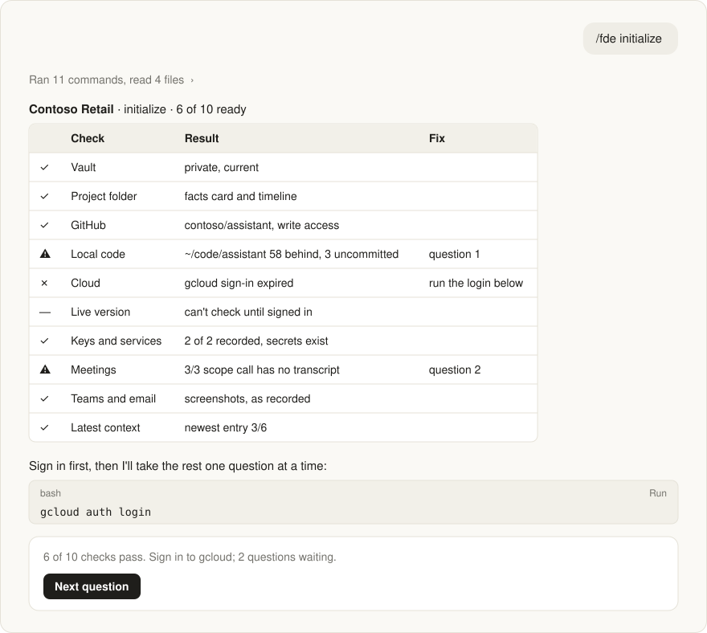
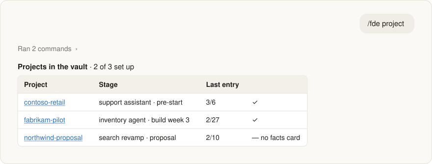
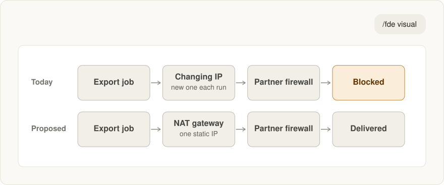

# /fde stack

A Claude Code skill for running a client project as a forward-deployed engineer.

<table>
<tr>
<td width="50%" valign="top"><br><code>/fde progress</code> · one bar per workstream</td>
<td width="50%" valign="top"><br><code>/fde recap</code> · cut a reply to a few lines</td>
</tr>
</table>

Both are example replies with made-up data. The progress bars are for Contoso, the sample project that ships with the skill.

## Try it in two minutes

Install it (below), then run `/fde progress`, `/fde timeline` or `/fde project` (with the plugin, `/fde:fde progress` and so on). They work at once against the bundled [sample vault](skills/fde/sample-vault/README.md), with no setup.

## Install

With the plugin (recommended), in Claude Code:

```text
/plugin marketplace add BrandeisPatrick/fde-stack
```

```text
/plugin install fde@fde-stack
```

The command is then `/fde:fde`, for example `/fde:fde progress`. Get updates with `/plugin marketplace update fde-stack`.

Or by hand, which gives the short `/fde`:

```bash
git clone https://github.com/BrandeisPatrick/fde-stack ~/code/fde-stack
```

```bash
mkdir -p ~/.claude/skills && ln -s ~/code/fde-stack/skills/fde ~/.claude/skills/fde
```

Get updates with `git -C ~/code/fde-stack pull`.

Then run `/fde initialize` to set up your own private [vault](skills/fde/references/vault-layout.md): it finds one or offers to create it, writes your settings, and checks that everything is ready. Run it again for each new project.

## What it needs

- Claude Code.
- The `gh` CLI, signed in.
- `gcloud` or `aws`, only if the project deploys there.
- A private GitHub repo for the vault. `/fde initialize` offers to create one.

## What it touches

- **It reads** your project repos, their cloud deployments (read-only checks), meeting transcripts, and Teams and email if you choose a method for them.
- **It stores** notes and transcripts only in your private vault, and full transcripts only when the vault passes its safe-place check.
- **It shares nothing client-related.** No client staff names, meeting quotes or commercial figures go into project repos, PRs, story pages or outside services.
- **It never stores** a key, token or password. The vault records where each key lives, not its value.
- **It asks first** before deleting or discarding work, merging a PR, or enabling GitHub Pages.

## Desktop app and terminal

In the Claude desktop app, questions arrive as buttons in the next-step box and diagrams draw inline. In the terminal, questions come as plain text at the end of the message, and diagrams are markdown tables or SVG files.

## Commands

Click a command to see an example reply.

<details>
<summary><code>/fde</code> · catch up on a project in one message</summary>


</details>

<details>
<summary><code>/fde initialize</code> · set up, then check everything is ready</summary>



</details>

<details>
<summary><code>/fde architecture</code> · see what runs where, and what is out of date</summary>


</details>

<details>
<summary><code>/fde progress</code> · one bar per workstream</summary>


</details>

<details>
<summary><code>/fde timeline</code> · what happened, day by day</summary>


</details>

<details>
<summary><code>/fde context</code> · the project's facts</summary>


</details>

<details>
<summary><code>/fde project</code> · every project in your vault</summary>



</details>

<details>
<summary><code>/fde visual</code> · redraw a reply as a diagram</summary>



</details>

<details>
<summary><code>/fde recap</code> · cut a reply to a few lines</summary>


</details>

<details>
<summary>In a session · build with a team of agents</summary>

- Opus plans and reviews; Sonnet agents build, each in its own worktree.
- Every change ships as a PR with a diagram.
- A private story page shows progress as it happens.

</details>

MIT license · [How it works](skills/fde/SKILL.md)
