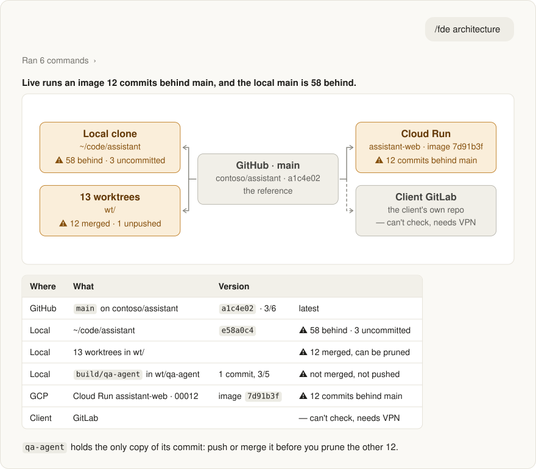
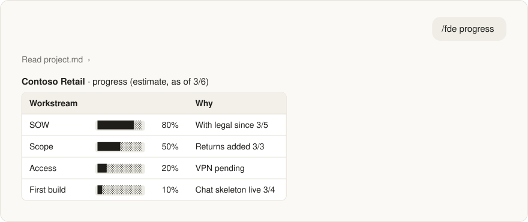
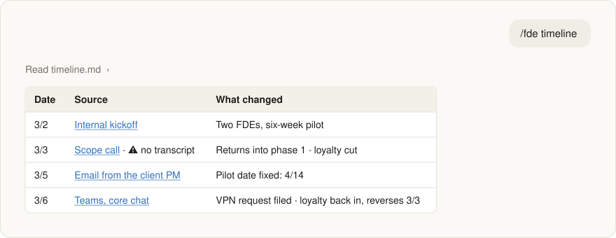
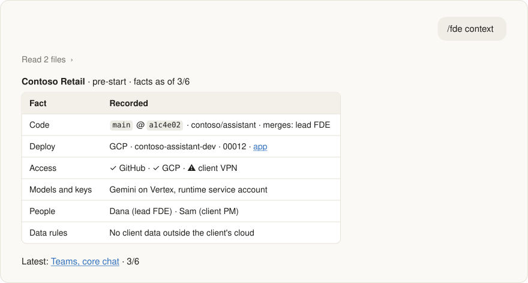

# /fde stack

A Claude Code skill for running a client project as a forward-deployed engineer. Click a command to see an example reply (Contoso is a placeholder company).

<details>
<summary><code>/fde</code> · catch up on a project in one message</summary>


</details>

<details>
<summary><code>/fde initialize</code> · set up, then check everything is ready</summary>


</details>

<details>
<summary><code>/fde architecture</code> · see what runs where, and what is out of date</summary>



</details>

<details>
<summary><code>/fde progress</code> · one bar per workstream</summary>



</details>

<details>
<summary><code>/fde timeline</code> · what happened, day by day</summary>



</details>

<details>
<summary><code>/fde context</code> · the project's facts</summary>



</details>

<details>
<summary><code>/fde project</code> · every project in your vault</summary>


</details>

<details>
<summary><code>/fde visual</code> · redraw a reply as a diagram</summary>


</details>

<details>
<summary><code>/fde recap</code> · cut a reply to a few lines</summary>


</details>

<details>
<summary>In a session · build with a team of agents</summary>

- Opus plans and reviews; Sonnet agents build, each in its own worktree.
- Every change ships as a PR with a diagram.
- A private story page shows progress as it happens.

</details>

## Install

```bash
git clone https://github.com/BrandeisPatrick/fde-stack ~/code/fde-stack
```

```bash
mkdir -p ~/.claude/skills && ln -s ~/code/fde-stack/skills/fde ~/.claude/skills/fde
```

Then run `/fde initialize` in Claude Code. It finds your private [vault](skills/fde/references/vault-layout.md) (or offers to create one), writes your settings, and checks that everything is ready.

v1 · [How it works](skills/fde/SKILL.md)
