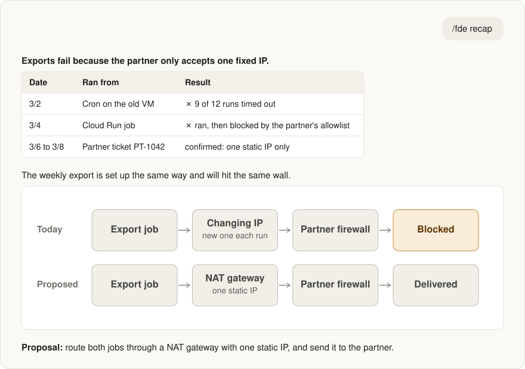

# /fde

[](https://github.com/BrandeisPatrick/fde-stack/actions/workflows/check.yml)
[](LICENSE)

A Claude Code skill for running client projects as a forward-deployed engineer: catch up in one message, build with a team of agents, ship every change as a reviewed PR.

<table>
<tr>
<td width="50%" valign="top"></td>
<td width="50%" valign="top"></td>
</tr>
<tr>
<td align="center"><code>/fde progress</code></td>
<td align="center"><code>/fde recap</code></td>
</tr>
</table>

## Quick start

In Claude Code:

```text
/plugin marketplace add BrandeisPatrick/fde-stack
```

```text
/plugin install fde@fde-stack
```

```text
/fde:fde progress
```

This runs against a bundled [sample project](skills/fde/sample-vault/README.md), so there is nothing to set up. You can also just ask: "how far along is Contoso?"

To use it on your own work, run `/fde:fde initialize` once per project.

<details>
<summary>Install without the plugin</summary>

```bash
git clone https://github.com/BrandeisPatrick/fde-stack ~/code/fde-stack
```

```bash
mkdir -p ~/.claude/skills && ln -s ~/code/fde-stack/skills/fde ~/.claude/skills/fde
```

The command is then `/fde` instead of `/fde:fde`. Update with `git -C ~/code/fde-stack pull`.

</details>

## Why

- **Start from facts.** Each session checks the code, the deployment and the latest decisions before anything is built.
- **One message, then one question at a time.** Status comes as headlines with links, never a wall of text.
- **Nothing gets lost.** Decisions, meetings and progress are written back to a private vault that any session can pick up.

## Commands

| Command | What it does | |
|---|---|---|
| `/fde` | Catch up on a project in one message | [example](docs/assets/screens/fde.svg) |
| `/fde initialize` | Set up a project and check it is ready | [example](docs/assets/screens/fde-initialize.svg) |
| `/fde progress` | One bar per workstream | [example](docs/assets/screens/fde-progress.svg) |
| `/fde timeline` | What happened, day by day | [example](docs/assets/screens/fde-timeline.svg) |
| `/fde context` | The project's facts | [example](docs/assets/screens/fde-context.svg) |
| `/fde project` | Every project in your vault | [example](docs/assets/screens/fde-project.svg) |
| `/fde architecture` | What runs where, and what is out of date | [example](docs/assets/screens/fde-architecture.svg) |
| `/fde visual` | Redraw a reply as a diagram | [example](docs/assets/screens/fde-visual.svg) |
| `/fde recap` | Cut a reply to a few lines | [example](docs/assets/screens/fde-recap.svg) |

With the plugin, each command is prefixed: `/fde:fde progress`. All examples use made-up data.

During a build, Opus plans and reviews while Sonnet agents work in separate worktrees. Every change ships as a PR with a diagram.

## Requirements

- Claude Code
- GitHub CLI (`gh`), signed in
- `gcloud` or `aws`, if the project deploys there
- A private GitHub repo for your notes (the vault); `/fde initialize` can create it

## Data handling

- **Reads** project repos, deployment state (read-only), meeting transcripts, and Teams and email if you enable them.
- **Stores** notes and transcripts only in your private vault.
- **Never** puts client names, meeting quotes or commercial figures in repos, PRs or outside services, and never stores keys or tokens.
- **Asks first** before deleting work, merging a PR or enabling GitHub Pages.

The desktop app shows questions as buttons and draws diagrams inline. The terminal uses plain text and tables.

## More

[How it works](skills/fde/SKILL.md) · [Changelog](CHANGELOG.md) · MIT license
