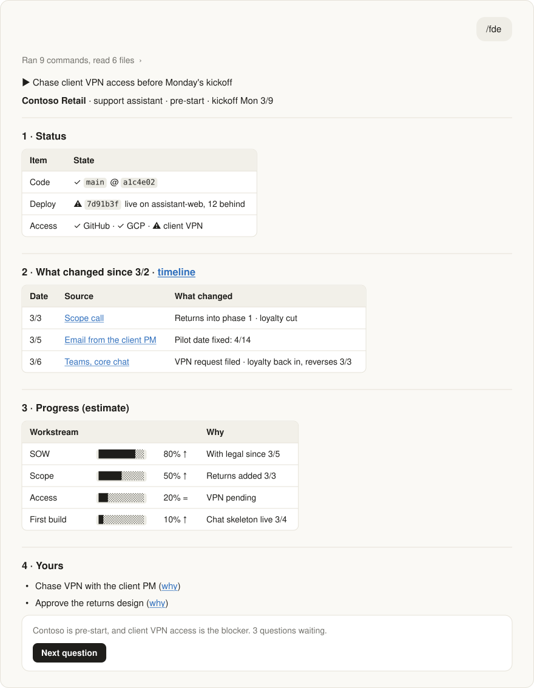
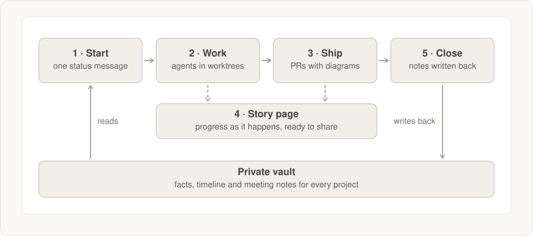
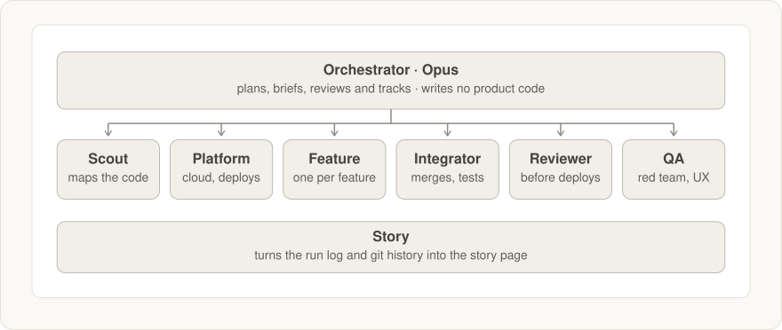

<h1 align="center">/fde</h1>

<p align="center">
<b>Run client projects as a forward-deployed engineer, with Claude Code.</b><br>
Catch up in one message. Build with a team of agents. Ship every change as a reviewed PR.
</p>

<p align="center">
<a href="https://github.com/BrandeisPatrick/fde-stack/releases"></a>
<a href="https://github.com/BrandeisPatrick/fde-stack/actions/workflows/check.yml"></a>
<a href="LICENSE"></a>

</p>

<p align="center">
<a href="#quick-start">Quick start</a> ·
<a href="#see-it-work">See it work</a> ·
<a href="#how-it-works">How it works</a> ·
<a href="#commands">Commands</a> ·
<a href="#data-handling">Data handling</a> ·
<a href="#faq">FAQ</a>
</p>

<table>
<tr>
<td width="50%" valign="top"></td>
<td width="50%" valign="top"></td>
</tr>
<tr>
<td align="center"><code>/fde progress</code></td>
<td align="center"><code>/fde recap</code></td>
</tr>
</table>

## What you get

<table>
<tr>
<td width="33%" valign="top"><b>Catch up in one message</b><br>Code, deployment, access, what changed and what is yours. Every line links to its source.</td>
<td width="33%" valign="top"><b>Build with a team of agents</b><br>Opus plans and reviews. Sonnet agents build in parallel, each in its own worktree.</td>
<td width="33%" valign="top"><b>Ship reviewed PRs</b><br>Every change lands as a PR with a diagram and an honest list of what was not checked.</td>
</tr>
<tr>
<td valign="top"><b>Know what is live</b><br>See every copy of the code, on your laptop, GitHub and the cloud, and which are out of date.</td>
<td valign="top"><b>Keep context between sessions</b><br>Decisions, meetings and progress live in a private vault that any session can pick up.</td>
<td valign="top"><b>Keep client data private</b><br>Names, quotes and figures stay in the vault, out of repos, PRs and outside services.</td>
</tr>
</table>

## Quick start

In Claude Code:

```text
/plugin marketplace add BrandeisPatrick/fde-stack
```

```text
/plugin install fde@fde-stack
```

```text
/fde:fde progress
```

This runs against a bundled [sample project](skills/fde/sample-vault/README.md), so there is nothing to set up. You can also just ask: "how far along is Contoso?"

To use it on your own work, run `/fde:fde initialize` once per project.

<details>
<summary>Install without the plugin</summary>

```bash
git clone https://github.com/BrandeisPatrick/fde-stack ~/code/fde-stack
```

```bash
mkdir -p ~/.claude/skills && ln -s ~/code/fde-stack/skills/fde ~/.claude/skills/fde
```

The command is then `/fde` instead of `/fde:fde`. Update with `git -C ~/code/fde-stack pull`.

</details>

## See it work

`/fde` at the start of a session. One message, and every line links to the note behind it:



<table>
<tr>
<td width="50%" valign="top"></td>
<td width="50%" valign="top"></td>
</tr>
<tr>
<td align="center"><code>/fde architecture</code> · what runs where</td>
<td align="center"><code>/fde initialize</code> · is everything ready</td>
</tr>
</table>

All examples use Contoso, a made-up company.

## How it works



| Part | What happens |
|---|---|
| **1&nbsp;·&nbsp;Start** | Reads the vault, checks the code, deployment and logins, then sends one status message. Questions follow one at a time. |
| **2&nbsp;·&nbsp;Work** | The main session orchestrates while agents build, each in its own worktree. |
| **3&nbsp;·&nbsp;Ship** | Branches are integrated, a PR opens with diagrams, and the build deploys. |
| **4&nbsp;·&nbsp;Story** | A private page shows the build as it happens, ready to share. |
| **5&nbsp;·&nbsp;Close** | Decisions and progress are written back to the vault. |

Skip what does not apply. A ten-minute fix needs part 1 and a PR.

### The agent team



| Agent | What it does | Works in |
|---|---|---|
| Scout | Maps the code and the cloud project before anything is built | Read-only |
| Platform | Builds cloud infrastructure and deploys | Its own worktree |
| Feature | Builds one feature, with its tests | Its own worktree |
| Integrator | Merges the agent branches, runs the full tests, keeps the PR current | The integration branch |
| Reviewer | Reviews correctness and security before each deploy | Read-only |
| QA | Red-teams and checks the deployed build | Read-only |
| Story | Turns the run log and git history into the story page | The vault |

### The vault

A private Git repo with one folder per project. `/fde initialize` creates it.

```text
vault/
├── platforms/         defaults shared by every project
└── <project>/
    ├── project.md     facts: code, deployment, access, people, workstreams
    ├── timeline.md    meetings and decisions, newest first
    ├── meetings/      condensed notes, one file per meeting
    └── story/         story page source and run log
```

## Commands

| Command | What it does | |
|---|---|---|
| `/fde` | Catch up on a project in one message | [example](docs/assets/screens/fde.svg) |
| `/fde initialize` | Set up a project and check it is ready | [example](docs/assets/screens/fde-initialize.svg) |
| `/fde progress` | One bar per workstream | [example](docs/assets/screens/fde-progress.svg) |
| `/fde timeline` | What happened, day by day | [example](docs/assets/screens/fde-timeline.svg) |
| `/fde context` | The project's facts | [example](docs/assets/screens/fde-context.svg) |
| `/fde project` | Every project in your vault | [example](docs/assets/screens/fde-project.svg) |
| `/fde architecture` | What runs where, and what is out of date | [example](docs/assets/screens/fde-architecture.svg) |
| `/fde visual` | Redraw a reply as a diagram | [example](docs/assets/screens/fde-visual.svg) |
| `/fde recap` | Cut a reply to a few lines | [example](docs/assets/screens/fde-recap.svg) |

With the plugin, each command is prefixed: `/fde:fde progress`.

## Requirements

- Claude Code
- GitHub CLI (`gh`), signed in
- `gcloud` or `aws`, if the project deploys there
- A private GitHub repo for the vault; `/fde initialize` can create it

## Data handling

<table>
<tr><td><b>Reads</b></td><td>Project repos, deployment state (read-only), meeting transcripts, and Teams and email if you enable them</td></tr>
<tr><td><b>Stores</b></td><td>Notes and transcripts, only in your private vault</td></tr>
<tr><td><b>Never</b></td><td>Puts client names, meeting quotes or commercial figures in repos, PRs or outside services. Never stores keys or tokens</td></tr>
<tr><td nowrap><b>Asks first</b></td><td>Before deleting work, merging a PR or enabling GitHub Pages</td></tr>
</table>

## FAQ

<details>
<summary>Do I need GCP or AWS?</summary>

No. Cloud checks are skipped for a project with no deployment.

</details>

<details>
<summary>Does it work in the terminal?</summary>

Yes. The desktop app shows questions as buttons and draws diagrams inline. The terminal uses plain text and tables.

</details>

<details>
<summary>Do I need a GitHub repo for the vault?</summary>

No. A local folder works, and nothing is pushed.

</details>

<details>
<summary>Where do meeting transcripts go?</summary>

Only into your vault. Full transcripts are kept only when the vault is private and readable by you alone; otherwise the skill keeps condensed notes and a link.

</details>

<details>
<summary>Is the sample data real?</summary>

No. Contoso, Fabrikam and Northwind are made up.

</details>

## Contributing

Issues and pull requests are welcome. [CLAUDE.md](CLAUDE.md) has the repo's rules and the checks to run.

## License

MIT · [Full skill text](skills/fde/SKILL.md) · [Changelog](CHANGELOG.md)
